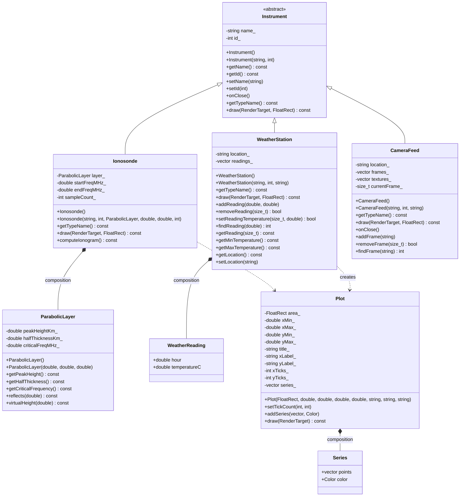

# Research Facility Simulation

A mock-up simulation of a research facility where the console is the control panel. Every instrument opens its own SFML window based on its gimmick (plot/images).
C++17, SFML 3.1 and CMake 3.20 required!

## Build and run

```bash
cmake -S . -B build
cmake --build build
./build/research_facility
```

Windows: `.\build\Release\research_facility.exe`.

Acquaint yourself with SFML documentation for [necessary dependencies](https://www.sfml-dev.org/tutorials/3.1/getting-started/cmake/#requirements) for your operating system.

## Example session

```
=== Research Facility Control ===
 1) Ionosonde - Ionosonde-01
 2) Weather station - WeatherStation-01
 3) Camera feed - CameraFeed-01
 0) Quit
Choice: 1
Opening Ionosonde "Ionosonde-01"...
[SFML window opens with the ionogram]
Window closed.
```

## Layout

```
CMakeLists.txt
include/   Instrument.h  Ionosphere.h  Plot.h
src/       main.cpp  Instrument.cpp  Ionosphere.cpp  Plot.cpp
gui/       pic1.png  pic2.png  terminus.ttf
```

## UML class diagram


